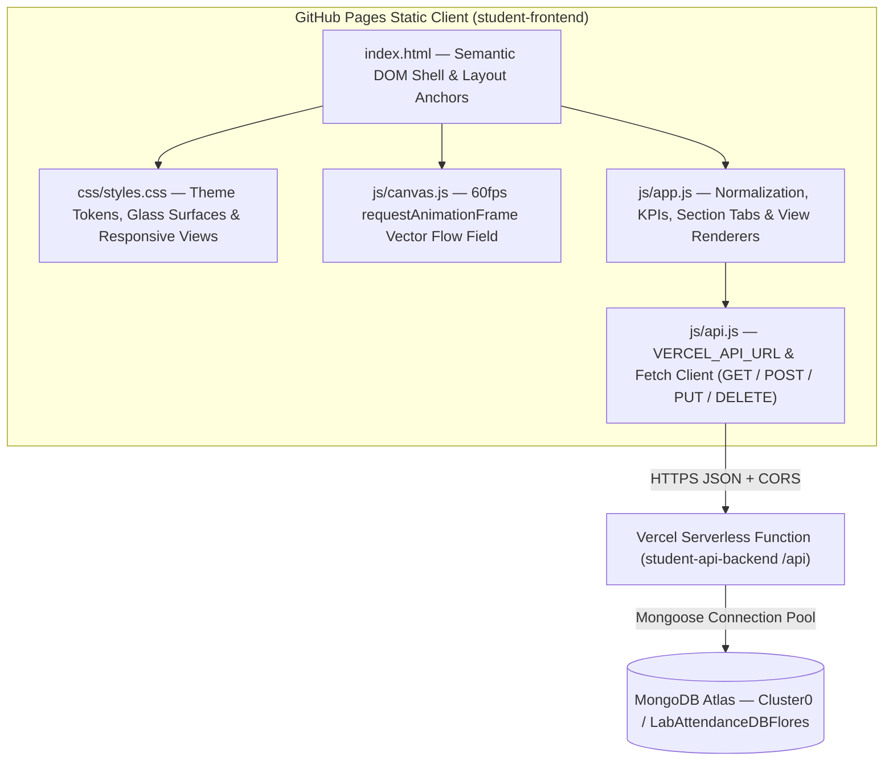

# Official Laboratory Attendance Roster — Frontend Portal

A high-density, modular static web application engineered for viewing, filtering, and logging university laboratory attendance records stored in **MongoDB Atlas** (`LabAttendanceDBFlores`) via a decoupled **Vercel Serverless API**.

- **Live Portal (GitHub Pages)**: [https://kenosis0.github.io/student-frontend/](https://kenosis0.github.io/student-frontend/)
- **Production API Endpoint**: `https://student-api-backend-two.vercel.app/api`
- **Companion Backend Repository**: [Kenosis0/student-api-backend](https://github.com/Kenosis0/student-api-backend)

---

## 1. Project Overview

Built with zero external JavaScript frameworks or build bundlers, this portal runs natively on **GitHub Pages** while delivering an enterprise-grade, academic data interface inspired by Vercel and Linear's technical design systems:

- **Live MongoDB Atlas Synchronization**: Fetches and renders all 50 enrolled student attendance histories (`daily_attendance`) alongside custom portal submissions (`records`).
- **Multi-View Roster Workspace**: Switches instantaneously between a 5-column **Table View** and an expandable single-line **Compact List View**.
- **Interactive Client-Side Vector Canvas**: Renders a 60fps HiDPI dot-matrix displacement field and cursor spotlight beneath translucent `backdrop-filter: blur(12px)` glass containers.
- **Collapsible Command Panel**: Houses `#dataForm` (`#title` and `#content`) inside a toggleable top drawer complete with optional student/section/date/status quick-assist prefill controls.

---

## 2. System & Module Architecture



### Directory Structure

```text
student-frontend/
├── index.html        # Pure semantic HTML5 structure (zero inline styles or scripts)
├── css/
│   └── styles.css    # Light/Dark CSS custom properties, glassmorphism, table & compact layouts
├── js/
│   ├── api.js        # VERCEL_API_URL constant, fetch wrappers, and localStorage endpoint config
│   ├── canvas.js     # Interactive HTML5 <canvas> dot-matrix ripple & radial spotlight engine
│   └── app.js        # Document unpacking, KPI metrics, dynamic section tabs, views & form logic
└── README.md         # Architecture, design system & deployment documentation
```

---

## 3. UI & Design System Highlights

### 1. Editorial & Technical Typography
- **Display Header**: *Instrument Serif* brings academic authority to the `Official Laboratory Attendance Roster (50)` masthead.
- **Interface Copy**: *Plus Jakarta Sans* ensures crisp legibility across student names, subjects, and controls.
- **Tabular Data**: *JetBrains Mono* aligns 2-digit zero-padded indices (`01`–`50`), student IDs (`2026-0001`), section cohort badges (`BSIT-3A 9332-AY226`), KPI counters, `GET /api` indicators, and ISO session pills.

### 2. Interactive Mouse-Flow Background (`js/canvas.js`)
- Fixed full-viewport `<canvas id="flowCanvas">` (`pointer-events: none; z-index: 0`) scaled to `window.devicePixelRatio`.
- Combines subtle harmonic ambient drift with a cursor-driven magnetic ripple wave and soft radial spotlight, adapting its palette automatically when toggling between **Light** (`data-theme="light"`) and **Dark** (`data-theme="dark"`) themes.

### 3. Unpacked Data Normalization & Color-Coded Attendance Pills (`js/app.js`)
Each MongoDB document is inspected by `normalizeRecord()`:
- **Structured Roster Documents**: Unpacks `roster_index`, `student_name`, `student_number`, `subject`, `section`, `section_code`, and `attendance_log`.
- **Manual Portal Records (`{ title, content }`)**: Gracefully maps `title` to the student column and parses pipe-delimited or date-stamped `content` strings so newly submitted records render seamlessly alongside the 50 roster students.
- **Session Log Badges (`YYYY-MM-DD · Status`)**:
  - `Present`: Soft emerald fill, dark green text, emerald status dot.
  - `Late`: Soft amber fill, warm ochre text, amber status dot.
  - `Absent`: Soft rose fill, crimson text, red status dot.

### 4. Dynamic Cohort Filtering & Real-Time KPI Strip
- **Summary KPI Bar**: Dynamically computes **Total Students**, **Present Rate** (`Present / Total Sessions`), **Late Count** (with absent log subcount), and **Active Sections** for the active filter selection.
- **Dynamic Section Tabs**: Automatically generated from `section_code` values in the live dataset (`All Sections (50)`, `BSIT-3A (8)`, `BSIT-3B (8)`, `BSCS-2A (7)`, `BSCS-2B (7)`, `BSCpE-4A (7)`, `BSCpE-4C (6)`, `BSIS-3A (7)`).
- **Keyboard Shortcuts**: Press `/` anywhere to focus the live search input (`name`, `student_number`, `subject`, `section`, `date`, or `status`), and `Esc` to dismiss open drawers or modals.

---

## 4. Academic Rubric Compliance

All required identifiers, DOM hooks, and global bindings are preserved across the modular architecture:

| Requirement | Location | Role |
| :--- | :--- | :--- |
| `VERCEL_API_URL` | `js/api.js` | Top-level constant pointing to `https://student-api-backend-two.vercel.app/api` (with optional `localStorage` override). |
| `loadRecords()` | `js/app.js` | Async function that fetches `/api` (`GET`), rebuilds section tabs & KPIs, and renders the active roster view. |
| `createRosterRecord()` | `js/api.js` | Submits new attendance records (`POST /api`) with Date, Subject Name, Section, Student Name, and Status. |
| `updateRosterRecord()` | `js/api.js` | Updates existing attendance records (`PUT /api?id=...`) via the interactive Edit Record modal (`#editRecordModal`). |
| `deleteRosterRecord()` | `js/api.js` | Deletes attendance records (`DELETE /api?id=...`) following user confirmation alert. |
| `#dataForm` | `index.html` | Attendance/record submission `<form>` inside the collapsible command drawer (`POST /api`). |
| `#title` | `index.html` | Required record title `<input>` (supports both manual entry and quick-assist auto-fill). |
| `#content` | `index.html` | Required record content `<input>` (supports both manual entry and quick-assist auto-fill). |
| `#recordsContainer` | `index.html` | Primary DOM mount target for skeleton states, Table View, and Compact List View. |
| `.card` | `js/app.js` / `css/styles.css` | Attached to every rendered record row (`tr.card.roster-row` and `div.card.compact-row`). |

---

## 5. Local Usage & GitHub Pages Deployment

### Running Locally
Because all asset references (`css/styles.css`, `js/api.js`, `js/canvas.js`, `js/app.js`) use relative paths and standard deferred scripts, the app runs without a build step:

```bash
# Option 1: Serve locally over HTTP
npx serve .

# Option 2: Open index.html directly in any modern browser
```

### Deploying to GitHub Pages
1. Push changes to the `main` branch of `Kenosis0/student-frontend`.
2. In GitHub, navigate to **Settings → Pages**.
3. Under **Build and deployment**, select **Deploy from a branch** → Branch: `main` → Folder: `/ (root)` and click **Save**.
4. If testing against a different backend deployment, click **⚙ Endpoint** (or the `GET /api` badge) in the portal header to override or reset the API URL in `localStorage`.
